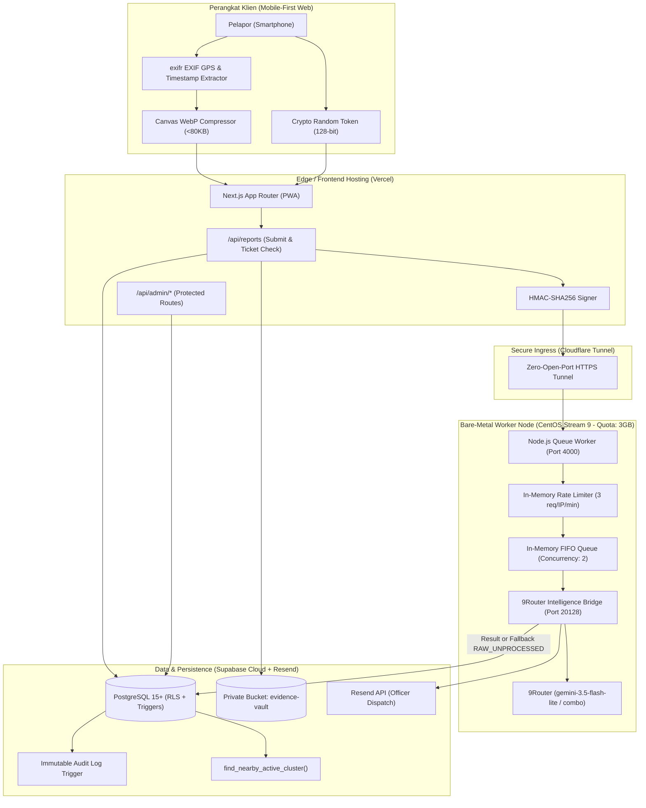

# FORMAL IMPLEMENTATION PLAN: GARDA-LOKAL / PAI
**Document Version:** 1.0.0-ULTRA-PLAN  
**Philosophy:** Spec-to-Ship, Asymmetric Pseudonymity, Forensic Accountability, Zero AI Slop, Hardware-Bound Reliability.

---

## 1. EXECUTIVE SUMMARY & SYSTEM TOPOLOGY

GARDA-LOKAL (Platform Anonim Insiden) adalah sistem pelaporan darurat kejadian lokal nasional (potensi bentrok/tawuran, perundungan/bullying, dan penyalahgunaan miras/narkoba/obat keras) yang memisahkan lapisan pelapor publik yang anonim dari instrumen verifikasi forensik penegak hukum/petugas komando.



---

## 2. VERIFIKASI PUSTAKA & STANDAR TEKNOLOGI (CONTEXT7 AUDIT)

Berdasarkan penelusuran pustaka via Context7 MCP:
1. **Peta Geospasial Klien (`Leaflet` + `React Leaflet`):**
   - *Issue*: `leaflet` dan `react-leaflet` mengakses `window` dan DOM secara langsung, memicu SSR hydration error pada Next.js App Router.
   - *Standard Architecture*: Komponen peta **wajib** dimuat secara asinkron menggunakan `next/dynamic` dengan opsi `{ ssr: false }`.
   - *Import Definition*: Mengimpor langsung dari paket root `react-leaflet` (`MapContainer`, `TileLayer`, `Marker`, `useMapEvents`) untuk menjamin kelengkapan TypeScript definition.
2. **Ekstraktor Forensik Kamera (`exifr`):**
   - *Issue*: Pemindaian penuh seluruh segmen TIFF/XMP memakan memori browser di ponsel spesifikasi rendah.
   - *Standard Architecture*: Gunakan pemanggilan spesifik `await exifr.gps(file)` untuk ekstraksi koordinat presisi cepat, dan `await exifr.parse(file, ['Make', 'Model', 'DateTimeOriginal'])` untuk metadata perangkat.
3. **Kompresi Gambar Canvas (HTML5 Canvas to WebP):**
   - *Constraint*: Ukuran file tersimpan wajib `< 80 KB` dengan lebar maksimal 1280px.
   - *Algorithm*: Resize proporsional dengan canvas 2D context (`imageSmoothingQuality = 'high'`), konversi `canvas.toBlob(callback, 'image/webp', quality)`, iterasi penurunan kualitas dari `0.8` hingga `0.5` jika ukuran awal $> 80 \text{ KB}$.
4. **Verifikasi Kriptografi (Node.js Crypto):**
   - *Anti-Timing Attack*: Validasi tanda tangan HMAC wajib menggunakan `crypto.timingSafeEqual(bufA, bufB)` untuk mencegah eksploitasi timing leakage.
   - *Anti-Replay Attack*: Selisih `|Date.now() / 1000 - timestamp| <= 60` detik.

---

## 3. DATA CONTRACTS & STATE BOUNDARIES

### 3.1. Database Schema Specifications (PostgreSQL)

| Tabel | Kolom Kunci | Proteksi & Aturan RLS |
|---|---|---|
| `reports` | `id`, `reporter_token_hash`, `category`, `status`, `urgency_score`, `credibility_score`, `public_masked_summary`, `admin_full_narrative`, `latitude`, `longitude`, `cluster_parent_id` | RLS: Publik hanya dapat membaca ringkasan via `reporter_token_hash`. Admin dapat membaca semua baris. |
| `report_forensics` | `report_id`, `compressed_image_path`, `original_file_sha256`, `compressed_file_sha256`, `exif_metadata`, `distance_pin_vs_exif_meters`, `is_metadata_consistent` | RLS: Khusus `authenticated` (Admin). Klien publik tidak diizinkan membaca jejak IP / EXIF. |
| `report_messages` | `id`, `report_id`, `sender_role` (`ADMIN` \| `REPORTER`), `message_text`, `created_at` | RLS: Pelapor membaca/menulis menggunakan token tiket; Admin membaca/menulis semua pesan. |
| `admin_audit_logs` | `id`, `report_id`, `admin_user_id`, `action_type`, `mandatory_note`, `created_at` | **APPEND-ONLY TRIGGER:** Operasi `UPDATE` dan `DELETE` diblokir langsung oleh fungsi PL/pgSQL `prevent_audit_log_modification()`. |

### 3.2. Skema Output Validasi AI (Zod Schema)

```typescript
export const GardaIntelligenceSchema = z.object({
  category: z.enum(['BENTROK', 'PERUNDUNGAN', 'MIRAS_NARKOBA', 'LAINNYA']),
  temporal_context: z.enum(['SEDANG_BERLANGSUNG', 'RENCANA_MENDATANG', 'KEJADIAN_LAMPAU']),
  urgency_score: z.number().int().min(0).max(100),
  credibility_score: z.number().int().min(0).max(100),
  is_potential_hoax: z.boolean(),
  hoax_reason: z.string().nullable(),
  public_masked_summary: z.string(), // Inisial (B.S.), aman publik
  admin_full_narrative: z.string(),  // Nama Lengkap, detail taktis
  extracted_entities: z.object({
    involved_persons_full_names: z.array(z.string()).default([]),
    weapons_or_substances: z.array(z.string()).default([]),
    specific_landmarks: z.array(z.string()).default([]),
    estimated_headcount: z.string().nullable().default(null)
  }),
  tactical_recommendation: z.string()
});
```

---

## 4. SECURITY & THREAT MODEL ANALYSIS

1. **Ancaman Replay Attack pada Webhook VPS:**
   - *Mitigasi*: Header `X-Garda-Timestamp` diverifikasi. Jika selisih waktu $> 60$ detik, request ditolak HTTP 401.
2. **Ancaman Flooding / DoS terhadap VPS 1GB RAM:**
   - *Mitigasi*: In-Memory Rate Limiter menolak alamat IP yang mengirimkan $> 3$ request dalam jendela 60 detik (HTTP 429).
   - *Mitigasi*: Array antrean FIFO membatasi konkurensi pemrosesan AI maksimal 2 worker paralel.
3. **Ancaman Pelanggaran Kuota Disk VPS (Limit: 3,000,000,000 Byte):**
   - *Mitigasi*: Foto bukti **DILARANG** disimpan di harddisk VPS. Gambar diunggah langsung dari Vercel ke Supabase Storage (`evidence-vault`). VPS hanya menerima payload teks JSON (<10 KB per request). Total penyimpanan VPS terkunci di ~31.6 MB (<1.5% dari kuota 3 GB).
4. **Ancaman Manipulasi Catatan Tindakan Petugas (Audit Tampering):**
   - *Mitigasi*: PostgreSQL trigger `trg_immutable_audit_logs` memblokir perintah `UPDATE` dan `DELETE` di level kernel database. Setiap akses baca laporan di admin otomatis memicu `READ_DETAIL`.

---

## 5. ATOMIC IMPLEMENTATION ROADMAP (PHASED EXECUTION)

### Fase 1: Validasi Fondasi & Lingkungan (STATUS: TERVERIFIKASI ✓)
- [x] Verifikasi koneksi SSH ke VPS `5.22.209.52:22` (CentOS Stream 9, non-sudo user `tugasagama`).
- [x] Verifikasi 9Router lokal pada port 20128 (`http://127.0.0.1:20128/v1`).
- [x] Pembuatan skema SQL migrasi `supabase/migrations/001_initial_schema.sql`.

### Fase 2: Service Worker VPS & Rate-Limiter (STATUS: TERVERIFIKASI ✓)
- [x] Pembuatan service Node.js di `vps-worker/index.mjs`.
- [x] Deployment ke VPS `/home/tugasagama/garda-vps` (100% user-space).
- [x] Uji live `/health` (HTTP 200, RSS ~55 MB).
- [x] Uji live verifikasi tanda tangan HMAC-SHA256 (`timingSafeEqual`).
- [x] Uji live rate-limiter: Request 1 & 2 lolos (202), Request 3 & 4 ditolak (429).
- [x] Audit kuota disk: 31,662,148 byte (~31.6 MB dari limit 3,000,000,000 byte).

### Fase 3: Pembangunan Web Pelapor & Dashboard Admin (`apps/web`) (STATUS: SEDANG BERJALAN)
- [ ] **Task 3.1: Core Utilities & Library Setup:**
  - Utilitas forensik EXIF + Canvas WebP kompresor `< 80 KB` (`lib/media-forensics.ts`).
  - Supabase client & HMAC Webhook Signer (`lib/supabase.ts`).
- [ ] **Task 3.2: Web Pelapor Publik (`/`):**
  - Desain Mobile-First taktis Slate Obsidian `#0B0F17`.
  - Formulir insiden single-screen: Kategori, Status Waktu, Kronologi, Landmark.
  - Peta Leaflet OpenStreetMap interaktif (dynamic import SSR false) + Reverse Geocoding.
  - Modal sukses & persistensi riwayat tiket lokal via SHA-256 token hash.
  - Lembar obrolan tiket dua arah pelapor <-> petugas.
- [ ] **Task 3.3: Web Dashboard Admin (`/admin`):**
  - Gerbang login berlapis (`/admin/login` dengan Supabase Auth + `ADMIN_ACCESS_CODE`).
  - Antrean laporan realtime (`/admin/dashboard`) dengan lencana klaster & filter prioritas.
  - Lembar forensik detail (`/admin/reports/[id]`):
    - Auto-read logging (`READ_DETAIL`) ke `admin_audit_logs`.
    - Tampilan narasi lengkap dan nama asli tanpa sensor.
    - Panel forensik EXIF (indikator GPS & waktu kamera asli vs pin peta).
    - Form ubah status yang mewajibkan pengisian catatan minimal 10 karakter.
    - Tabel audit trail permanen (*immutable log view*).

### Fase 4: Pengujian & Integrasi End-to-End
- [ ] Uji coba pengiriman laporan lengkap dari browser (foto kamera asli -> WebP <80KB -> Supabase -> Webhook VPS -> 9Router Triage -> Dashboard Admin).
- [ ] Verifikasi audit log permanen (coba hapus baris audit log dari console SQL Supabase).
- [ ] Uji verifikasi batas kuota penyimpanan di VPS.
